# Osteon

Anki-style flashcards that live inside your Obsidian notes. Write a card as a line in a note, study
it with one-key grading and FSRS scheduling, and keep notes and cards in one place on the computer and
the phone.

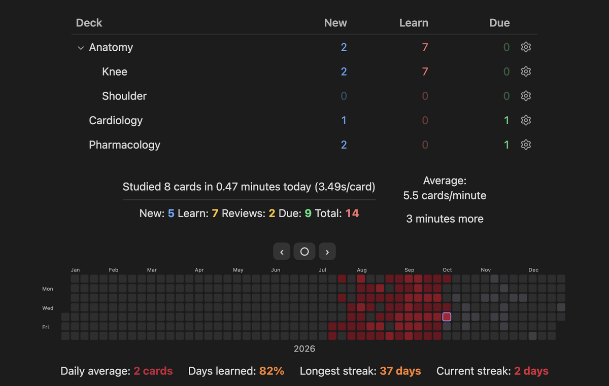

**What it does**

- [Your notes, one key away from any card](#your-notes-one-key-away): stuck on a card, press N
  and its note opens beside it
- [Cards written in your notes](#cards-written-in-your-notes), with a real back side
- [Fast keyboard review](#review) with FSRS scheduling, undo, flags, bury and suspend
- [One-by-one reveals](#one-by-one-reveals) for cards with several answers
- [Image occlusion](#image-occlusion) drawn on any picture in the vault
- [Decks, presets and custom study](#decks-and-options)
- [Statistics and a review heatmap](#statistics)
- [A card browser](#browse) with a search language
- [Deck import (.apkg)](#importing-decks-apkg), with review history
- [An AI helper beside the card](#ai-helpers-optional) that explains it and answers questions, with
  your own key from any provider (optional)
- [Medical-term hover](#medical-term-hover)
- [Leeches, weak spots and timed sittings](#finding-what-you-keep-missing)
- [Works on iPhone and iPad](#iphone-and-ipad) through Obsidian mobile, with the same cards and
  history
- [Card themes, a home-screen shortcut, game controllers and more](#more), and an
  [add-on API](#for-add-on-authors)

## Your notes, one key away

This is the reason Osteon exists. A flashcard holds one fact, and the note it came from holds the
explanation. When a card is hard, press **N** and the note opens beside the card, scrolled to the
line the card was written on. Read around it, then carry on reviewing.

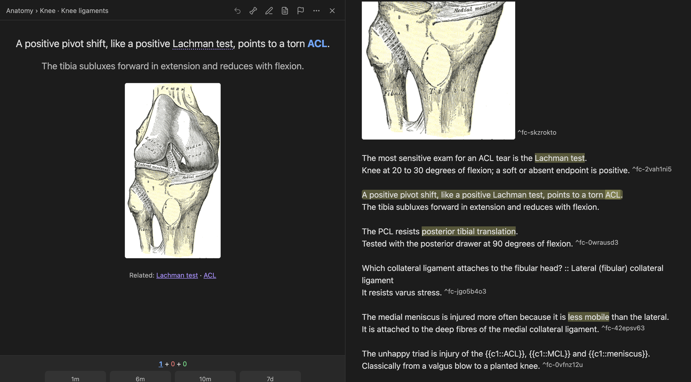

- **Pictures from the note:** if a card has no picture of its own, its back shows the figures from
  the same section of the note.
- **Related notes:** the back lists notes whose title the card mentions. Click one, or press N on
  an imported card to open the best match.
- **Term hover:** hover a term on the back to see the first paragraph and pictures of your own
  note about it.
- **From the note back to its cards:** **Osteon: Study this note's cards** (also in the note's
  menu) builds a deck from one note, and `note:"..."` works in Browse and filtered decks.
- **Edit in place:** E edits the card without leaving the review, and the change is written to the
  note.
- **Linked decks:** a vault can ship a table that ties each card of an imported deck to the note
  about it, so a shared deck opens the right note too.

**Link any note to any card.** If a card keeps sending you back to the same note, tie them
together: in a review, open the ⋯ menu and choose **Link a note to this card**. From then on N
opens that note from that card, and it leads the Related row. It works on every card, including
cards from an imported deck, and the link follows the note if you rename or move it. Unlink from
the same menu.

The picker first offers the notes that look related to the card. Type to search: titles, aliases
and headings, with the words in any order. If you have the Omnisearch plugin, the picker uses it
and searches inside your notes too.

**Imported decks work differently.** A card from an imported deck was not written in one of your
notes, so there is no source note for N to open. Instead N opens a note you linked to the card,
or else a note of yours that the card names. If there is none, it tells you so and opens the deck's
own card file. The AI helper can also point you to the right note: it lists the notes of yours it
judges relevant under each explanation. The cards you write in your own notes always open
the exact line.

## Cards written in your notes

Add `#flashcards` to a note (or list its folder in settings). Then write:

```md
The most commonly torn rotator cuff tendon is ==supraspinatus==.
Tested with the empty can (Jobe) test.

Which nerve supplies supraspinatus and infraspinatus? :: Suprascapular nerve

The rotator cuff muscles are {{c1::supraspinatus}}, {{c1::infraspinatus}}, {{c1::teres minor}} and {{c1::subscapularis}}.
![[rotator-cuff.png]]
```

The first line is the front. The lines under it are the back, shown only after you answer, so the
explanation never has to be squeezed into the blank. Pictures, links, lists and math work on either
side. Three styles are understood: `==highlight==` clozes, `{{c1::answer::hint}}` clozes, and
`Question :: Answer` (`:::` makes a reversed pair too). A deck is the note's folder, or a
`#flashcards/deck/subdeck` tag.

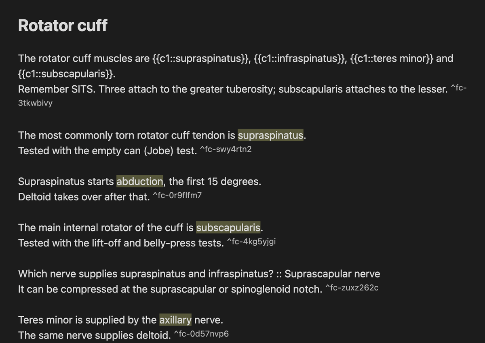

The full syntax is in [`docs/claude-code-skill/SKILL.md`](docs/claude-code-skill/SKILL.md), which
also works as a Claude Code skill for writing cards. **Add card** (A) writes a card into a note for
you, and **Osteon: Migrate from Spaced Repetition…** converts cards from the Spaced Repetition
plugin and keeps their schedules.

## Review

Open the deck list from the ribbon icon or **Osteon: Open decks**. Space shows the answer, then **1 Again · 2 Hard · 3 Good · 4 Easy**.

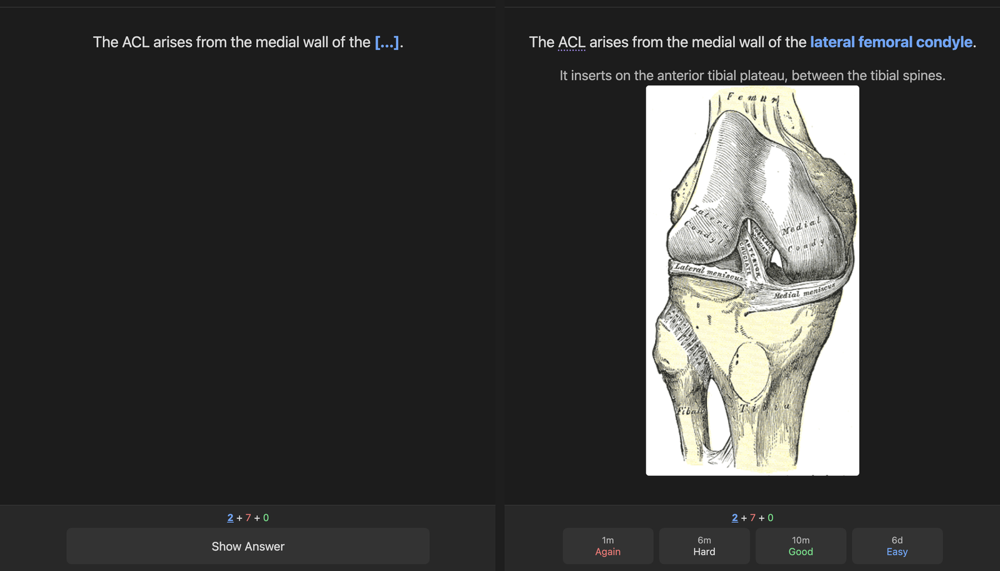

- D decks, B browse, A add card, T stats
- U or ⌘Z undo, E edit the card in place, N open its note
- \* mark, ⌘1–7 flags, \- bury, @ suspend, ⌘⇧D set due date
- I card info, O deck options

Every key can be changed in settings. Scheduling is [FSRS](https://github.com/open-spaced-repetition),
and a deck's parameters can be optimised from your own history.

A game controller works too.

## iPhone and iPad

Osteon runs inside Obsidian mobile, so there is no second app and nothing to export. The same
notes, cards and review history are on the phone as soon as your vault syncs (iCloud or Obsidian
Sync).

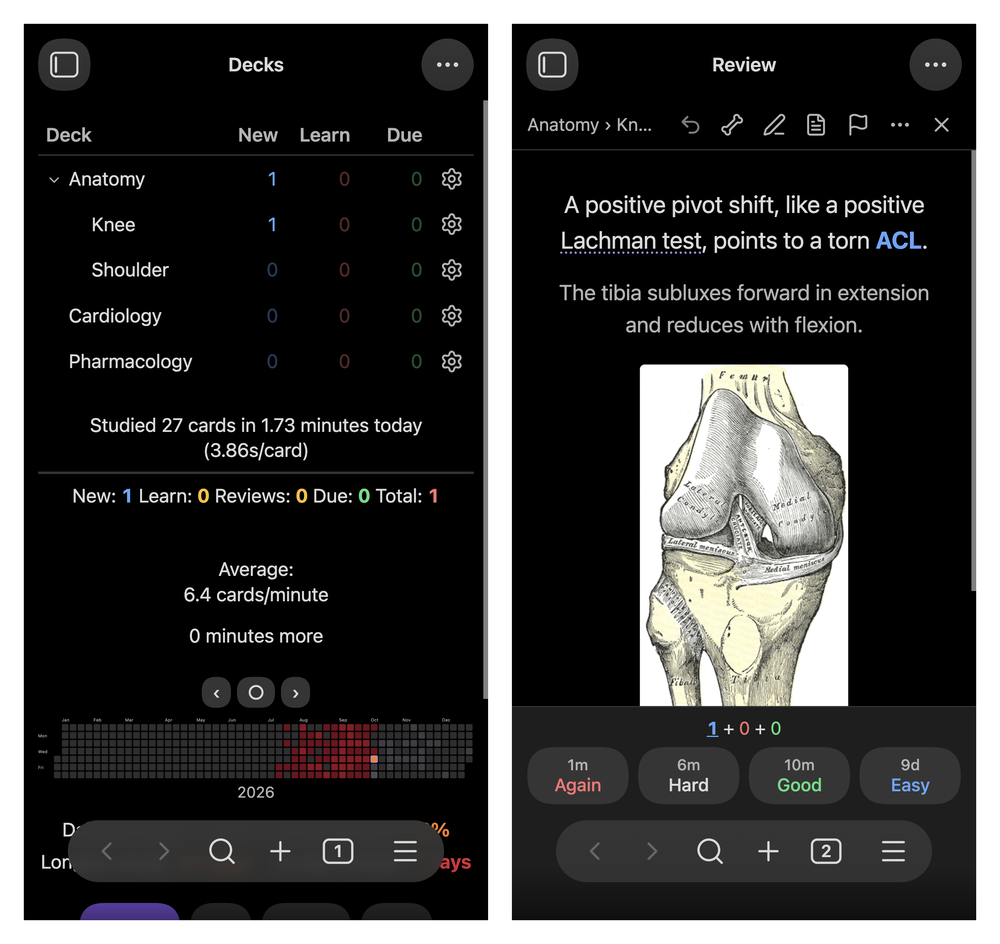

- Tap the right third of the screen for Good and the left third for Again, or use the buttons.
- Shake to undo.
- Tap a term for its definition, tap a figure to zoom, and open the card's note the same way.
- Each device keeps its own review log, so studying on the phone and the computer never conflicts.
- Osteon warns you if iCloud has offloaded your pictures from the phone.

## One-by-one reveals

A card that asks for two or more answers hides each one behind a 🦴 and reveals them one at a time, so a
list is recalled item by item instead of all at once. N or Space reveals the next, a click reveals
that one, and comma reveals all. The bone button above a card switches it on or off for that card.

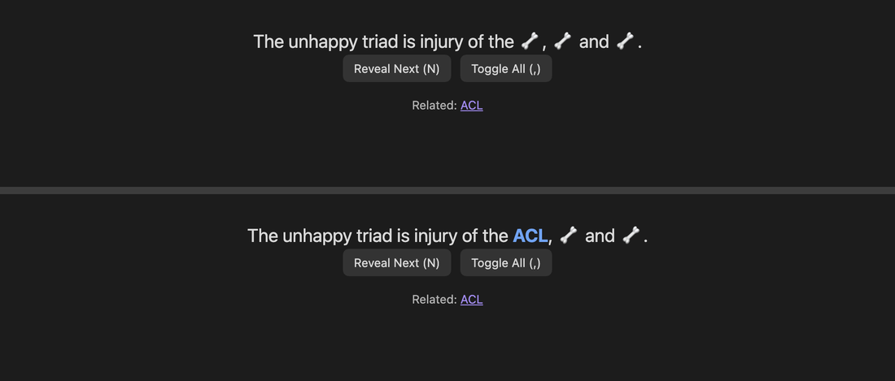

## Image occlusion

Put a picture on a line of its own, right-click the line and choose **Create image occlusion**.
Draw rectangles, ellipses or polygons over the labels. Each box, or group of boxes, becomes a card.
**Hide all, guess one** suits labelled diagrams and **Hide one, guess one** suits X-rays.

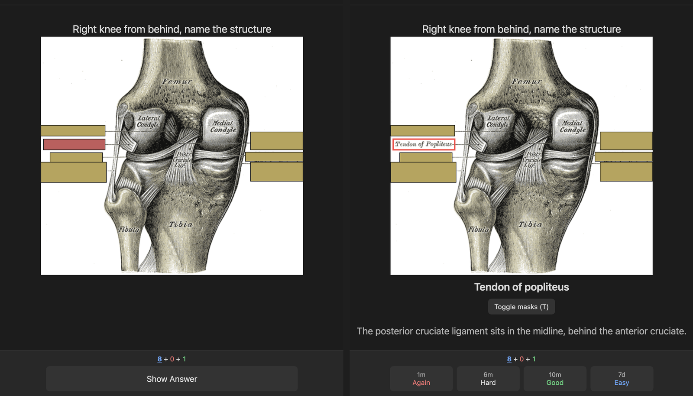

In review, tap the figure to zoom and press T to uncover every box. In the note, the figure still
shows, with an **Edit occlusion** button. Renaming the image updates the figure.

## Decks and options

The gear next to a deck opens its options: presets shared between decks, new and review
limits, learning steps, leech threshold, display order, burying, timers and FSRS parameters. Decks
can be renamed or hidden from the same menu.

- **Custom Study** (C on a deck): raise today's limits, review forgotten cards, review ahead,
  preview new cards, or study by state or tag.
- **Filtered decks** (F): a saved search with a limit and order, with Rebuild and Empty.
- **Timed sittings:** 5, 10, 15 or 20 minutes from a deck's overview.
- **Pacing (optional):** hold back new cards while many are still in learning, and rest a card
  after several misses in one day.

## Statistics

**Stats** has graphs for Today, Future Due, Calendar, Reviews, Card Counts, Intervals,
Stability, Difficulty, Retrievability, Hourly, Answer Buttons, Added and True Retention. The year
heatmap and streaks also sit under the deck list; click a day to browse its cards.

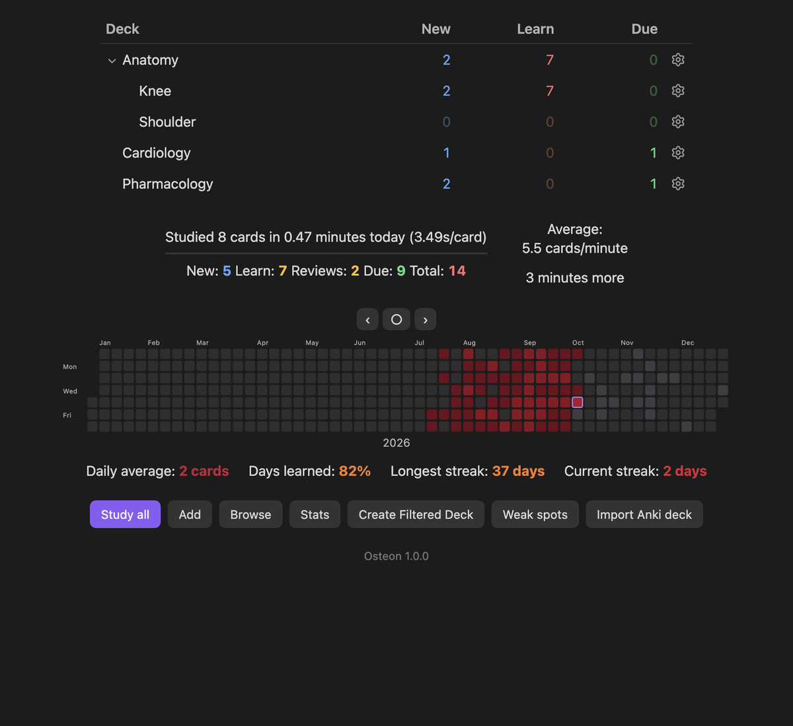

## Browse

**Browse** takes searches such as `deck:Anatomy is:due`, `tag:high-yield`,
`flag:1`, `prop:ivl>30` or `rated:7`, plus `is:onebyone`, `front:word` and `A or B`. Select cards to
suspend, flag, reschedule or switch them to one-by-one in bulk.

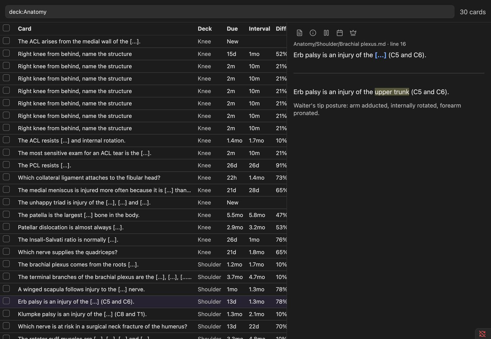

## Finding what you keep missing

- **Leeches:** cards that reached the deck's leech threshold, each with Rewrite, Split into
  one-by-one, Try again or Drop.
- **Weak spots:** miss rate by topic and the most-missed cards for today, 7 or 30 days, with a
  practice run that isn't recorded.
- **Find cards to rewrite:** lists overstuffed cards whose explanation sits inside the blank.
- **Exam results:** with a vault that ships an `*.exammap.json` table, enter the questions you
  missed on a practice exam and study the notes behind them.

## Medical-term hover

After you reveal a card, medical terms are underlined. Hover on the computer, or tap on the phone,
to see a short definition without leaving the card.

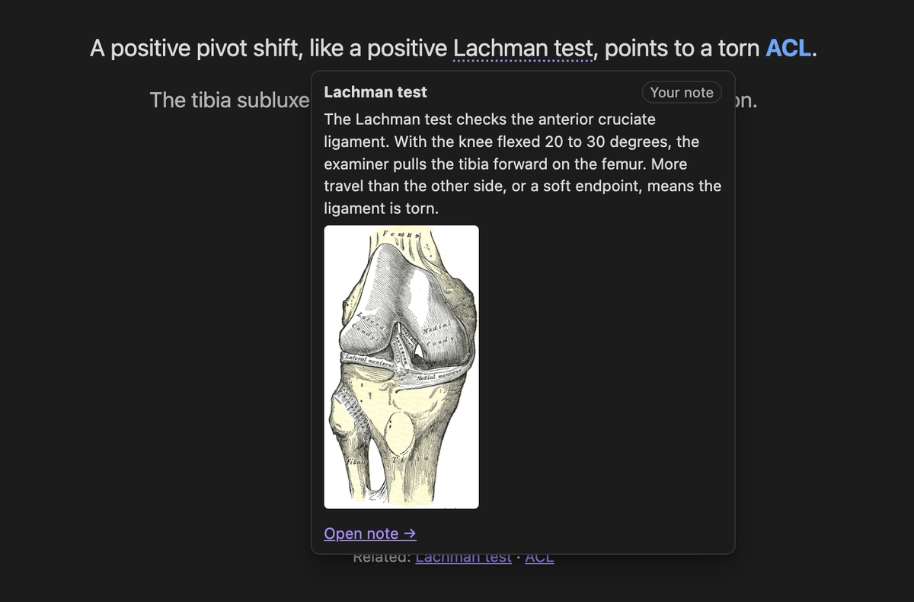

Definitions come from, in order:

1. **Your own notes:** a note whose title or alias matches the term. The popup shows its first
   paragraph and pictures.
2. **Your list:** `Flashcards/glossary/My terms.md` (command **Open My terms**).
3. **MeSH:** the National Library of Medicine's vocabulary. Press **Download** in settings, once
   per device.
4. **AI**, if you turn it on.

Everyday words aren't underlined. Underlines on the front of a card are off by default, because a
definition can give away the answer.

## AI helpers (optional)

Pick a provider in settings, add your own API key and the model's name (filled in for you with
Claude and Gemini), then turn on **Use AI**. Anthropic (Claude),
OpenAI, Google Gemini and OpenRouter are built in, and **Other** takes any service that accepts
OpenAI-style requests, including a model running on your own computer (Ollama, LM Studio).

**AI helper panel.** Press H during a review, or the sparkle button above the card, and a panel
opens beside the card. **Explain this card** tells you why the answer is what it is and gives a
memory hook. Then ask anything else about the card in the box below.

- **Its own explanation.** The helper answers from its own knowledge, not by repeating your note.
- **It checks your note.** Notes can be wrong. The helper reads the part of your note the card came
  from, and if it conflicts with the facts it says so under **Check your note**.
- **Links to your notes.** The helper is shown the titles of your notes that might fit and picks the
  ones that are truly about the card. They are listed under each answer, and a click opens one
  beside the card.
- **No spoilers, no surprises.** It stays quiet until the answer is showing, follows you from card
  to card, and sends nothing until you press a button.

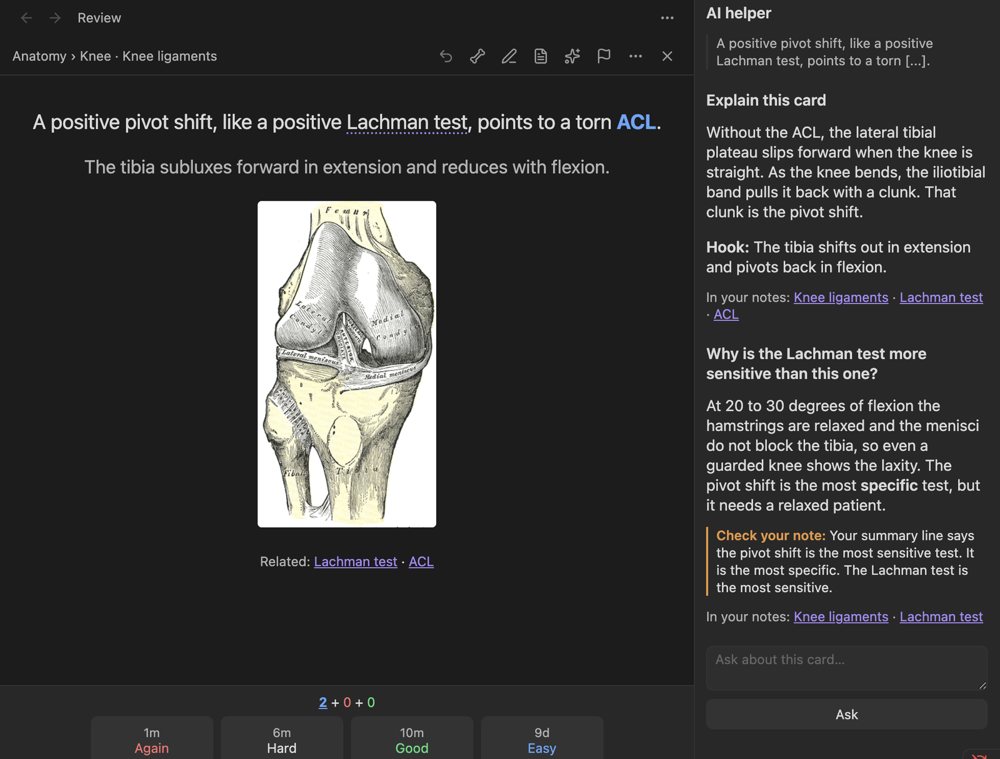

Also:

- **Hard terms:** finds terms the dictionaries miss, like eponyms, abbreviations and
  classifications, and writes one- or two-sentence definitions for the term hover. They are saved
  in the vault, so each card is looked at once and the definitions work offline on the phone.
- **Suggest split:** proposes a short front plus a back for an overstuffed card. Nothing is
  written until you press Accept.

AI answers can be wrong, including about medicine. Treat them as a study aid and check anything
you will rely on; the panel says so too.

For hard terms, new cards are looked at in small batches in the background (this can be turned
off). Bigger runs always ask first.

## Importing decks (.apkg)

Run **Osteon: Import deck (.apkg)…**, or press **Import deck** under the deck list, and pick the
file. It works for shared `.apkg` decks and for your own exports (tick "Include scheduling
information" when exporting to keep your history).

A preview shows what's inside. The deck is then written into the vault as notes, one per sub-deck,
with its pictures beside them, and old image-occlusion notes become real occlusion figures. If the
export included review history, cards keep their exact memory state.

Importing a newer version of the same deck only adds the new notes, or, with **Update cards
imported before**, rewrites the old ones and keeps their history (never cards you edited in
Obsidian). Very large decks with gigabytes of media are best imported on a computer.

Osteon ships no decks. Bring your own.

## More

- **Card themes:** several looks for the card, a background picture, and a font size.
- **Home-screen shortcut:** point an Obsidian widget or bookmark at a shortcut note to open your
  decks in one tap, or use the links `obsidian://osteon` and `obsidian://osteon?study`.
- **Game controller:** grade, undo and reveal from a controller, with remappable buttons.
- **Auto advance and timers:** show the answer and move on after a set time.
- **Card info:** a card's full review history and memory state (I).
- **Syncs cleanly:** each device writes its own review log, so iCloud or Obsidian Sync never has
  to merge two devices' answers, and card IDs are ordinary block IDs in your notes.
- **Card callouts:** keep cards in a `> [!card]` callout if you prefer them boxed.

## For add-on authors

`app.plugins.getPlugin("osteon").api` provides:

- `registerReviewDecorator(fn)`
- `on("cardShown" | "answerShown" | "answer" | "sessionEnd", cb)`
- `cards(search)`, `cardState(key)`, `history(key)`
- `suspend`, `unsuspend`, `bury`, `reset`, `flag` and `setDue`

See `src/plugin/api.ts`.

## Installing

In Obsidian, go to **Settings → Community plugins → Browse**, search for **Osteon**, then install
and enable it. If your vault syncs its settings folder (iCloud or Obsidian Sync), enable it on the
phone too.

To install by hand, download `main.js`, `manifest.json` and `styles.css` from the
[latest release](../../releases/latest) into `<your vault>/.obsidian/plugins/osteon/`.

Recommended: **Settings → Files and links → Excluded files**, then add `Flashcards/reviews` so the
review logs stay out of search and the graph.

Review history lives in `Flashcards/reviews/<device>/<month>.md`. Each device writes only its own
files, so a sync service never has to merge them.

## Network use, files and privacy

Osteon has no telemetry, no ads and no account. It contacts the internet in two cases only, both
started by you:

- **MeSH download** (`nlmpubs.nlm.nih.gov`): when you press **Download** for the medical-term hover,
  it fetches the National Library of Medicine's public MeSH vocabulary. Nothing is sent.
- **AI helpers:** only if you add your own API key and turn on **Use AI**. The text of the cards
  being looked at, and for a question in the helper panel the part of the note around that card
  and the titles of related notes, is sent to the provider you picked (Anthropic, OpenAI, Google, OpenRouter, or the
  server address you typed) to write definitions, explanations or rewrite suggestions. Usage is
  billed by that provider.

Files outside the vault are read in two cases, both started by you: the `.apkg` file you pick to
import, and (desktop only) **Copy deck pictures into the vault**, which reads the media folder of the
flashcard app profile you choose so that imported cards get their pictures.

Your API key is kept in Obsidian's secret storage on that device. The optional **Sync the key**
switch (off by default) also writes it, in plain text, to `api-key.json` in the plugin's folder so
your other devices pick it up. Leave it off if your vault is shared or public.

## Development

```sh
npm install
npm test        # parser, scheduler/replay, queue, and data-layer integration tests
npm run build   # typecheck + bundle to main.js
```

Tests use a throwaway sample vault in `test/fixtures/vault/` and an in-memory mock of the
Obsidian API (`test/mocks/obsidian.ts`).

## Credits and license

MIT licensed (see `LICENSE`). Scheduling uses the open [FSRS](https://github.com/open-spaced-repetition)
algorithm through [`ts-fsrs`](https://github.com/open-spaced-repetition/ts-fsrs) (MIT). It also bundles
[sql.js](https://github.com/sql-js/sql.js), [fflate](https://github.com/101arrowz/fflate),
[fzstd](https://github.com/101arrowz/fzstd), [zod](https://github.com/colinhacks/zod) and the
[Anthropic SDK](https://github.com/anthropics/anthropic-sdk-typescript) (all MIT), and a common-English
word list from [google-10000-english](https://github.com/first20hours/google-10000-english). Osteon is an
independent project, not affiliated with or endorsed by Anki or its developers. It ships no decks.

The anatomy plates in the screenshots are from Gray's *Anatomy* (1918), public domain.
